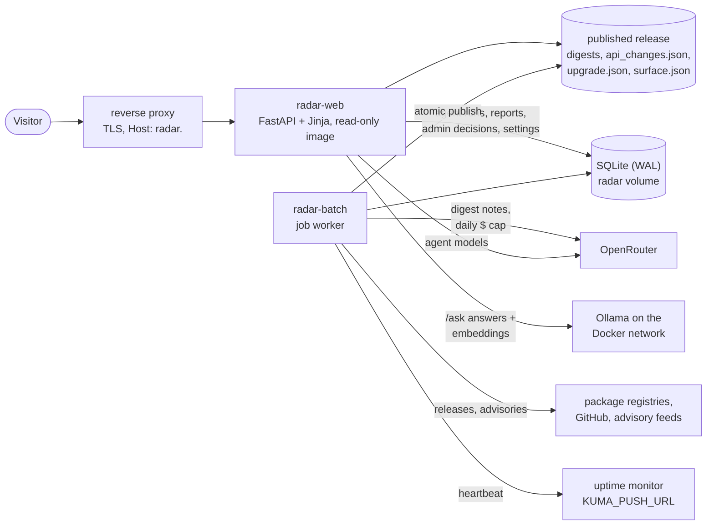
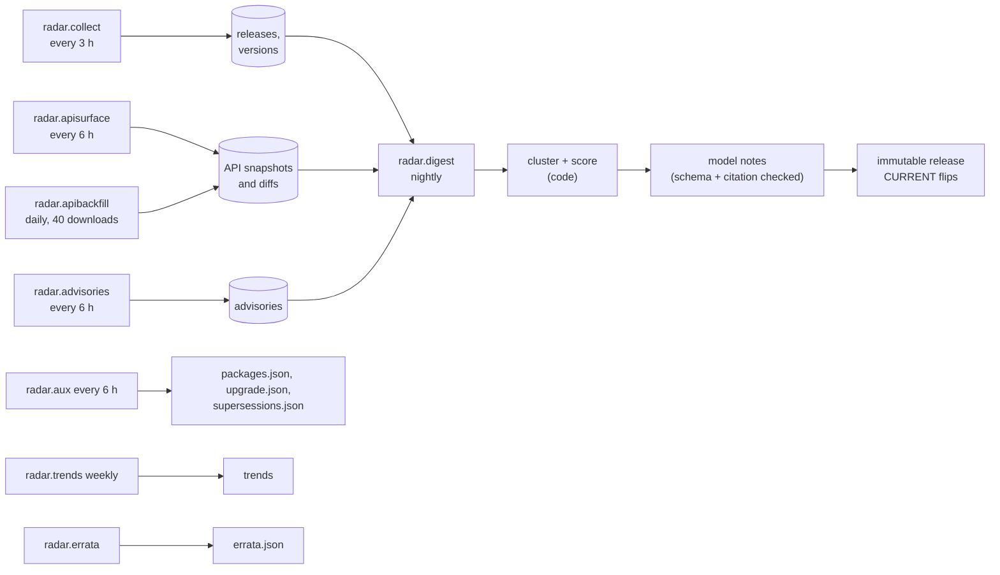

# Radar: architecture

How Radar (`radar.naveenlabs.tech`) is built, secured and run. This document covers Radar only. What was built and
when: [`HISTORY.md`](HISTORY.md).

Last reviewed: 2026-10-09.

## 1. What Radar does

| Feature | Where | How |
|---|---|---|
| Daily digest | `/`, `/digests/<date>`, `/archive`, `/c/<date>/<cluster>` | Releases, API changes and advisories of tracked AI libraries, clustered and ranked by code; a model writes short notes |
| Sources | `/sources` | Source health, the public signal formula, what is validated |
| Feed | `/feed.xml`, `/feed` | Every cluster of the last 14 digests for feed readers |
| Ask Radar | `/ask` | "What broke in X" and "CVEs in X" answered from data with no model; other questions search the archive and a local model answers, every sentence cited |
| Upgrade report | `/upgrade` | A pasted dependency file is read in the browser and compared with Radar's API changes; nothing is sent |
| Trends | `/trends` | Weekly counts per entity plus one validated model note |
| Upgrade agent | `/agent` | Finds code in a public repository that breaks when the tracked libraries are upgraded (section 4) |

The rule that runs through all of it: **models explain, code decides.** Impact, signal and every number come from
code; a model sentence is kept only when it cites real items.

## 2. Containers and data



- **web** serves published data, answers `/ask` and `/api/report`, and runs the upgrade agent on background threads.
- **batch** runs the durable job worker (leases, cached stages, backoff, dead-letter).
- Radar's published data volume can be mounted read-only by other apps; Radar itself reads nobody else's data.
- `/ask` needs an Ollama server reachable on the Docker network (`OLLAMA_URL`); without it, data answers still work
  and model answers say the model is unavailable.

## 3. The digest pipeline (batch)



- **Digest notes:** one paid model on OpenRouter (`BATCH_MODEL`, data collection denied) under a daily dollar cap
  (`BATCH_DAILY_USD`, default $0.03). If the cap closes or the model is unavailable past the deadline, the digest is
  published with the computed facts and notes marked "unsynthesized"; if fewer than 80% of official sources answered
  it is marked "partial". Published digests are never rewritten; corrections are errata.
- **API coverage:** `radar.apibackfill` snapshots about two years of minor releases per tracked package, and
  `api_changes.json` holds every version step uncapped, so the upgrade report and agent can chain changes across
  versions.
- **Sources:** `radar/sources.toml` (packages, feeds, starter packages); entity names in `radar/entities.toml`;
  unknown entities a model names wait in `/admin` to be aliased.
- **Publishing:** files plus a SHA-256 manifest, then `CURRENT` flips; web verifies before serving; 10 releases kept.

## 4. The upgrade agent (`/agent`)

```mermaid
flowchart LR
    input["repo URL or<br/>pasted dependency file"] --> fetch["fetch_inputs"] --> parse["parse_deps<br/>requirements, pyproject,<br/>package.json, locks"]
    parse --> ground["ground<br/>Radar's API changes"] --> index["index_code<br/>Python + TS usage"]
    index --> plan["plan (model)"] --> inv["investigate loop (model)<br/>read-only tools"]
    inv --> verify["verify (code)<br/>quote must be on the cited line"]
    verify --> report["report (model)<br/>route, difficulty, security,<br/>patch, checklist"]
```



- LangGraph graph; everything except plan, investigate and the report text is plain Python.
- **Models:** `AGENT_FAST_MODELS` and `AGENT_STRONG_MODELS` on OpenRouter (DeepSeek, GLM; data collection denied);
  `AGENT_PUBLIC_MODELS` may list a free model used only for public-repository runs, never for pasted files.
- **Limits** (defaults in `.env`, changeable from the owner's console): $0.05 and about 3 minutes per run (plus 45 s
  kept for the report), 8 candidates, 30 tool calls; runs per visitor per day; runs at once and a queue; a daily cap
  (`AGENT_DAILY_USD`, default $1.00; currently overridden to $0.25).
- **Repository content is untrusted:** fenced in prompts; tools only read the fetched snapshot; nothing from a
  repository is ever executed.
- **Shared agent runtime** (`core/agent/`): gateway with budgets, backup model and real cost; run store and runner;
  server-sent events that survive a reload; recorded runs replay at no cost (`showcase=1`). A restart marks runs in
  flight as failed. Visitor keys are salted hashes.

## 5. Owner controls

Stored in Radar's own database (`core/control/`): `agent.enabled`, `agent.daily_usd`, `agent.run_usd`,
`agent.per_ip_day`, `agent.concurrent`, `agent.queue`; `batch.enabled`, `batch.daily_usd`; `global.brake_pct` (pause
paid work past this % of the OpenRouter key's weekly limit, default 90); `global.stop_all`. The value in effect is the
`.env` default unless overridden; every change is stored with a note. The owner's private console uses
`/internal/control` (404 through the proxy, without the token, or when `CONTROL_TOKEN` is unset).
Its report also lists the latest 20 agent runs and batch jobs as metadata only (when, mode, outcome, duration, cost,
job type, a short error); never the visitor's input, their hashed address, the job payload or the run id, which is the
private result link.

## 6. Security

| Threat | Control |
|---|---|
| Interception | TLS; HTTP to HTTPS; HSTS one year with subdomains |
| Script injection | Strict CSP, no inline code; auto-escaping templates |
| Clickjacking | `frame-ancestors 'none'`, `X-Frame-Options: DENY` |
| Flooding | Per-IP limits (`/api/ask` 10 a minute, `/api/report` 5 a minute, agent runs per day), capped bodies, concurrency gate |
| Runaway model spend | Per-run budget before every call; daily caps; weekly brake; stop-all; the key's own weekly limit |
| Admin takeover | `/admin` 404 without a 16+ character password; rate-limited, constant-time, same-origin |
| Prompt injection from release notes or repositories | Untrusted text fenced and labelled; schema-checked output; citation and quote checks in code |
| Visitor privacy | "My stack" and "since last visit" live in the browser only; `/upgrade` never uploads the file |
| Container breakout | Non-root, read-only web filesystem, no capabilities, `no-new-privileges`, CPU and memory limits |
| Leaked secrets | `.env` / `batch.env` on the server only (mode 600); GitHub token fine-grained, public read only |

## 7. Reliability

| Failure | What happens |
|---|---|
| web unhealthy | `/healthz` fails; external probe alerts; restart the container |
| Crash | `restart: unless-stopped`; leased jobs return; agent runs in flight marked failed |
| A source fails | Source health on `/sources` and `/admin`; the digest is labelled "partial" below 80% |
| Daily cap or model outage | Digest published with facts and "unsynthesized" notes |
| Rate limit (OpenRouter or GitHub) | Retry after the provider's reset; GitHub token raises the limit |
| Weekly budget nearly used | Brake pauses new agent runs and digest notes with a message |
| Bad release | Hash check refuses it; point `CURRENT` back |
| Worker silent | Heartbeats stop; the uptime monitor marks the worker down after about 30 minutes |

Data: one SQLite database (WAL) in Radar's volume, backed up nightly by the server's backup job.

## 8. Operations

Written in ASD-STE100 style (Simplified Technical English): one instruction in each step, active voice, short
sentences. Do all the steps on the server, as root.

### Procedure 1: Deploy a new version

1. Go to the Radar folder:

   ```bash
   cd /opt/radar
   ```

2. Write down the current commit. You need it if you must go back (Procedure 2).

   ```bash
   git rev-parse --short HEAD
   ```

3. Get the new version:

   ```bash
   git pull
   ```

4. Build and start the app:

   ```bash
   docker compose up -d --build
   ```

5. Make sure that the web container is healthy. Do this command until it shows `healthy` (about 30 seconds).

   ```bash
   docker inspect -f '{{.State.Health.Status}}' radar-web-1
   ```

6. Make sure that the worker started without errors. The command must show `0`.

   ```bash
   docker logs --since 2m radar-batch-1 2>&1 | grep -c Traceback
   ```

   If the command shows more than `0`, read the log (`docker logs --since 2m radar-batch-1`). A missing package
   usually means that `requirements.txt` was not made again after a dependency change.

7. Make sure that the public site answers. The command must show `200`.

   ```bash
   curl -s -o /dev/null -w '%{http_code}\n' https://radar.naveenlabs.tech/healthz
   ```

8. Do this step only on the first deploy. Fill the API history. Do this command three times. Each time downloads more old versions.

   ```bash
   docker exec radar-batch-1 python -m radar.cli backfill
   ```

### Procedure 2: Go back to the previous version

Use this procedure if Procedure 1 fails at step 5, 6 or 7.

1. Go to the Radar folder (`cd /opt/radar`).
2. Get the commit that you wrote down in Procedure 1, step 2:

   ```bash
   git checkout <commit>
   ```

3. Do Procedure 1, steps 4 to 7 again.

### Procedure 3: Stop the upgrade agent immediately

Use this procedure if the agent costs too much or gives bad results. The agent stops when any one of its switches is
off. Runs that started before continue to their limits.

1. Open `https://radar.naveenlabs.tech/admin` and log in.
2. Push "Turn live runs off".
3. Open `https://radar.naveenlabs.tech/agent`. Make sure that it shows "Live runs are paused".

To keep the agent off after a restart, also set `AGENT_ENABLED=0` in `/opt/radar/.env`. Then do this command:

```bash
docker compose up -d --force-recreate web
```

CAUTION: If the owner's control console has an override that sets `agent.enabled` to on, the `.env` value has no
effect. The switch in `/admin` always works.

To stop all paid work in Radar (agent and batch), set "stop all" in the control console.

### Settings

`.env.example` lists every setting. Shared code comes from the `atlas` monorepo (`CORE_VERSION`; `scripts/sync_core.py --check`).

## 9. Quality gates

- About 850 tests in CI on every push.
- Diff evaluation (`python -m evals.radar_eval`); agent evaluation (`python -m evals.radar_agent_eval`: precision at
  least 0.9, recall at least 0.8 offline; `--live` with real models before a deploy).

## 10. Known limits

- Static analysis flags `langgraph.prebuilt.*` as removed; it moved to a sister package.
- Model-proposed patches are suggestions; check them against the listed API changes.
